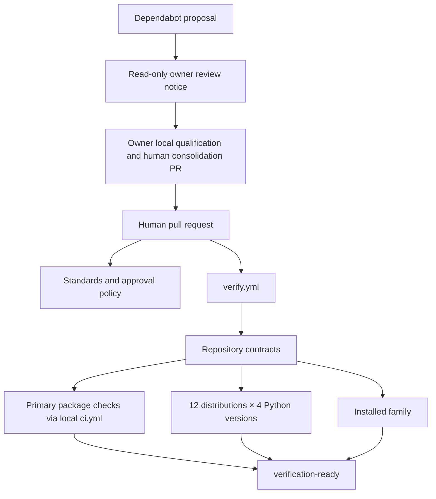

# GitHub Workflows

GitHub Actions routes repository events to checked-in commands and preserves
their verification, approval, artifact, and publication verdicts.

## Verification and dependency admission

Human pull requests retain all product, standards, and approval requirements.
Dependabot proposals and exact `github-actions[bot]` lock-refresh proposals
from `automation/dependency-lock-refresh` run only a distinct receipt notice.
Other bot branches and human-authored changes retain full verification. A successful notice
supplies no required verification status and cannot merge the proposal.
Accepted pull-request verification is the source of the merged product verdict;
`main` pushes do not repeat the full Actions graph. GitHub's dependency graph
can update from the merged manifests without another product workflow run.

## Workflow inventory

| Workflow | Entry point | Result |
| --- | --- | --- |
| `verify.yml` | human pull request, merge group, dispatch | repository, package, interpreter, and installed-family verification |
| `ci.yml` | reusable call from verification | inline package tests, lint, quality, security, API, build, and SBOM |
| `bijux-std.yml` | human pull request, merge group, dispatch | accepted-source standards verdict |
| `github-policy.yml` | human pull request, merge group, dispatch | generated-file, checksum, action-pin, and policy verdicts |
| `pr-approval-policy.yml` | human pull-request target and review events | owner review or `owner-self-signoff` enforcement |
| `dependency-notice.yml` | Dependabot pull-request target | read-only owner review notice, without verification or merge authority |
| `automerge-pr.yml` | manual dispatch | explanation of required owner consolidation; never enables auto-merge |
| `deploy-docs.yml` | admitted manual dispatch | verified Pages artifact and deployment |
| `release-artifacts.yml` | reusable call | staged distribution and release artifacts |
| `release-pypi.yml` | admitted manual dispatch | authenticated PyPI publication |
| `release-ghcr.yml` | admitted manual dispatch | GHCR release bundle publication |
| `release-github.yml` | admitted manual dispatch | GitHub Release and attached assets |

Publication requires an explicit accepted commit and release tag, authorized
controller admission, and the channel's own credentials and environment gates.
Neither a merge, a tag, nor a green notification publishes a release.

## Documentation deployment

`deploy-docs.yml` resolves repository build and verification commands, packages
the site, then deploys it through a separate Pages job. A successful local
MkDocs build proves site construction; the deploy job proves hosting behavior.
Documentation publication remains an explicitly admitted operation.

## Ownership and evidence

Managed workflow headers identify `bijux-std` as their source. Change shared
execution policy upstream and refresh its exact accepted projection. Supported
repository configuration and Make profiles own package-specific behavior.

When reading a run, identify its event and original pull-request author, follow
its job dependencies and local calls, inspect the actual command and artifacts,
and distinguish a notice, skip, refusal, failure, and successful verification.

- [Verify](verify.md) describes the complete product graph and dependency notices.
- [Reusable workflows](reusable-workflows.md) describes package and artifact calls.
- [Deploy docs](deploy-docs.md) describes Pages construction and publication.
- [Release workflows](release-workflows.md) describes the publication channels.
