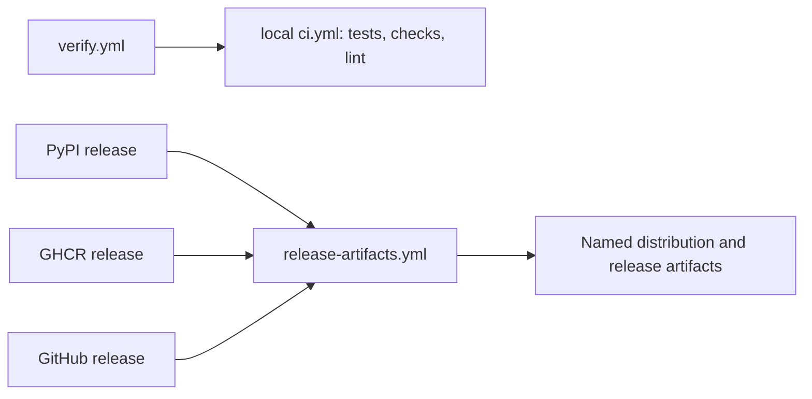

# Reusable Workflow Contracts

The caller owns the event, package matrix, and required result. The called
workflow owns validated inputs, runner setup, command execution, and artifact
handoff. Canon consumes these managed files from an accepted `bijux-std` source;
the local workflow bytes show exactly what the hosted runner executes.

## Package verification

The primary matrix calls local `ci.yml` with package slug, package directory,
artifact directory, JSON Python-version and check-target lists, API toolchain
targets, and an optional post-test command.

The local callee executes inline test, check, and lint jobs using pinned actions,
Python, uv, Node 24, and Java 17 where the API contract needs them. It invokes
repository-owned Make profiles. It does not delegate to an old remote Python
workflow at another commit. The caller's `verification-ready` gate also requires
the separate supported-interpreter matrix and installed-family check.

Original-author dependency admission covers Dependabot and `github-actions[bot]`
only when its head branch is exactly `automation/dependency-lock-refresh`. It
happens in the pull-request caller before
package runners are allocated. A read-only notice replaces execution on bot
proposals; it does not return a product verdict. Qualified dependency changes
require a human-authored consolidation pull request with every applicable gate.

## Release artifacts

`release-artifacts.yml` accepts a package slug, package and artifact directories,
optional profile path, build targets, and distribution subdirectory. It:

1. checks out the exact admitted workflow commit with full history;
2. provisions Python 3.11 and uv;
3. resolves an absolute package profile path;
4. installs the profile and invokes each requested build target;
5. refuses a distribution tree without a wheel or source archive;
6. stages PyPI distributions separately from release assets; and
7. uploads `<slug>-pypi-dist` and `<slug>-release` with bounded retention.

Release assets include distribution files and available production and
development SBOMs with normalized names. Channel publishers consume these named
artifacts. They require explicit controller admission and accepted commit proof;
a dependency notice never authorizes publication.

## Permission and ownership boundaries

| Concern | Caller | Reusable workflow |
| --- | --- | --- |
| event and publication intent | owns | does not infer |
| package and target selection | supplies bounded inputs | validates and executes |
| credentials | grants through job or environment | requests only declared permissions |
| artifact name and retention | consumes contract | produces contract |
| required verification status | evaluates all product groups | returns actual job result |

Verification and release artifact construction read repository content.
Publication grants identity-token, package, or repository-content write only to
the destination job that needs it. Superseded verification can be canceled;
approved release construction retains its own concurrency contract.

Shared workflow changes belong in `bijux-std`, followed by accepted-source
refresh and checksum validation. Repository configuration supplies supported
package and release inputs without hand-editing generated workflow files.
