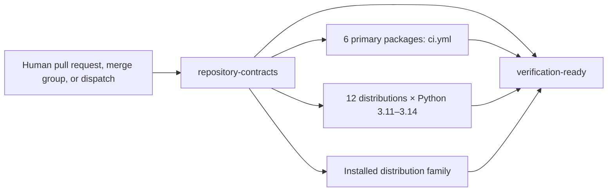

# Repository Verification Workflow

`.github/workflows/verify.yml` verifies human-authored pull requests, merge
groups, and manual dispatches. Accepted pull-request checks carry the product
verdict into `main`; a merge does not start the same verification graph again.



## Repository contracts

The repository job runs independently of prerequisite workflow polling:

```text
make check-shared-bijux-py check-config-layout check-make-layout help
```

It checks synchronized Make standards, configuration layout, Make entrypoints,
and the public help surface. Package checks begin after this job succeeds.

## Product verification

The primary matrix includes runtime, agent, ingest, reason, index, and the
internal development package. Each calls local `ci.yml`, which executes inline
Python tests, static and security checks, API contracts, and distribution
construction with pinned runner actions. Node 24 and Java 17 provision the API
toolchain. Package Make profiles retain ownership of the commands and thresholds.

Runtime checks include `openapi-drift` and configured post-test coverage
thresholds. The development package has no API targets. Package checks do not
request a nonexistent leaf `docs` target; documentation has its own repository
build and deployment contract.

A separate supported-interpreter matrix tests all twelve primary and
compatibility distributions on Python 3.11, 3.12, 3.13, and 3.14. It runs one
package per job with up to twelve concurrent jobs. The installed-family job
builds and installs the distribution family, verifies its thirteen installed
metadata records, and runs `uv pip check` in an isolated environment.

The terminal `verification-ready` job requires successful repository, primary
package, supported-interpreter, and installed-family results. Its required
status does not replace the detailed checks or turn cancellations into success.

## Dependency proposals

A pull request whose original author is `dependabot[bot]`, or whose original
author is `github-actions[bot]` with the exact head branch
`automation/dependency-lock-refresh`, receives only the read-only `dependency / owner review notice`. Product and policy jobs are guarded
before allocating runners. Their bot-visible names use the `unverified
dependency / ` prefix, so a skipped job cannot masquerade as a required green
verification context. The notice confirms receipt, not tests or security.

An owner reviews all requested files, qualifies compatible changes locally, and
includes them in a human-authored consolidation pull request. That pull request
must pass the full product graph and approval policy. Re-running a bot proposal
as a human does not change its original-author admission. Automatic merge is
disabled; the notice never grants merge permission.

## Reading a failure

| Failed job | Investigate first |
| --- | --- |
| `repository-contracts` | standards, configuration tree, Make layout |
| primary package job | package profile and retained check artifacts |
| supported interpreter job | that distribution's installation and product tests |
| installed family | build metadata, import surfaces, dependency consistency |
| `verification-ready` | dependency results, failures, or cancellation |

Retain a real failure and repair its owning surface before submitting another
revision. A fresh revision requires affected local qualification; rerunning an
unchanged failed head does not supply new evidence.

## Change ownership

Workflow execution policy is managed by `bijux-std`. Consume an accepted exact
source and validate its generated projection and shared checksums. Package
behavior belongs in repository-owned Make profiles and configuration. See
[CI Targets](../makes/ci-targets.md) for the local command families.
